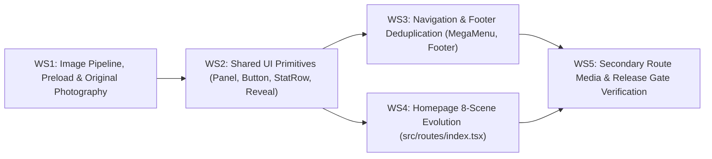

# PHASE 0 — DELIVERABLE 9: PHASE 1 DEPENDENCY-ORDERED IMPLEMENTATION BACKLOG

**Document ID:** `09_PHASE1_IMPLEMENTATION_BACKLOG.md`  
**Verified Repository Commit:** `c01704c1b3298361b796558aa629cc18cb632ba0`  
**Audit Branch:** `docs/wavenox-phase0-design-blueprint`  
**Phase 0 Status:** Planning Only — Do Not Execute Phase 1 Tasks Until Phase 0 Blueprint Is Approved

---

## 1. Execution Architecture & Dependency Order

Phase 1 is structured into **five sequential, non-breaking workstreams (`P1-WS1` through `P1-WS5`)** so that asset pipeline improvements, shared system primitives, navigation refinements, and the 8-Scene Homepage evolution land cleanly without breaking any Step 1–8 unit, E2E, accessibility, or performance gate:

---

## 2. Detailed Task Specifications

### Task `P1-01` (WS1) — Fix Image Build Pipeline Upscaling & Mobile Hero AVIF Weight

- **Priority:** `P1` (Performance & Visual Crispness)
- **Dependencies:** None (First task to execute in Phase 1).
- **Target Source Files:**
  - `scripts/build-images.mjs`
  - `public/media/home-hero-mobile.avif` (and generated responsive variants in `public/media/`)
- **Problem Diagnosed in Phase 0:**
  1. `scripts/build-images.mjs` calls `.resize({ width })` across `[640, 960, 1280, 1600, 1920]` without `withoutEnlargement: true`, upscaling `1024px–1376px` masters to `1920px`.
  2. `public/media/home-hero-mobile.avif` is `436.2 KB` (`800w` encoded at high bitrate), inflating `/` mobile page weight to `1.79 MB`.
- **Proposed Implementation:**
  1. Add `withoutEnlargement: true` to all Sharp `.resize()` calls in `scripts/build-images.mjs` (or ensure all master sources in `src/assets/` are `>= 1920px` wide).
  2. Tune mobile portrait hero output (`*-mobile.avif` / `*-mobile.webp`) to `720w` (`360px` `@2x`) with AVIF `{ quality: 50, effort: 6 }` and WebP `{ quality: 74 }`.
- **Safe Boundaries:** Do not break any filename referenced in `src/config/media.ts` or `src/components/system/Media.tsx`.
- **Test Requirements:** Run `node scripts/build-images.mjs` and verify file sizes in `public/media/`.
- **Acceptance Criteria:**
  - `public/media/home-hero-mobile.avif` is **`<= 65 KB`** (down from `436.2 KB`).
  - Zero generated derivatives in `public/media/` are upscaled beyond their master source dimensions.

---

### Task `P1-02` (WS1) — Align `<head>` Hero Preload Links With `<Media>` AVIF Selection

- **Priority:** `P1` (Eliminates Double Hero Image Download on Mobile & Desktop)
- **Dependencies:** `P1-01`
- **Target Source Files:**
  - `src/routes/index.tsx`
  - `src/routes/residential.tsx`
  - `src/routes/omnigrid.tsx`
  - `src/routes/enterprise.tsx`
- **Problem Diagnosed in Phase 0:**
  - All four showroom routes preload `.webp` in their `head()` links (`rel="preload" as="image" type="image/webp"`), while `<Media>` renders `<source type="image/avif">` first—causing modern browsers to download both the preloaded `.webp` AND the displayed `.avif`.
- **Proposed Implementation:**
  - Update the `head()` preload links in `index.tsx`, `residential.tsx`, `omnigrid.tsx`, and `enterprise.tsx` to `type="image/avif"` pointing to the exact `.avif` mobile (`media="(max-width: 767px)"`) and desktop (`media="(min-width: 768px)"`) `imageSrcSet` / `href` selected by `<Media>`.
- **Safe Boundaries:** Keep canonical URLs, OpenGraph tags, Twitter cards, and JSON-LD structured data in `head()` 100% untouched.
- **Test Requirements:** Inspect Playwright network waterfall on `/` (`390×844` and `1440×900`) to confirm only 1 hero image request fires per viewport.
- **Acceptance Criteria:**
  - Zero duplicate `.webp` + `.avif` hero downloads on `/`, `/residential`, `/omnigrid`, and `/enterprise`.
  - Mobile `/` total transfer weight drops from `1.79 MB` to **`<= 1.15 MB`**, and LCP remains well under the `2,500 ms` budget (`< 700 ms` local).

---

### Task `P1-03` (WS1) — Commission & Integrate Original WAVENOX Master Photography (Categories B, C, D, F)

- **Priority:** `P1` (Visual Authenticity & Elimination of Duplicate / Abstract CGI Slugs)
- **Dependencies:** `P1-01`
- **Target Source Files:**
  - `src/assets/` (replace duplicated/CGI masters while preserving `home-hero-master.jpg`, `home-hero-mobile-master.jpg`, `luxury_solar_villa.jpg`, `og-core.jpg`, and `enterprise_mw_rooftop.jpg`)
  - `src/config/media.ts`
  - `scripts/build-images.mjs`
- **Problem Diagnosed in Phase 0:**
  - 3 slug pairs are byte-for-byte duplicates (`res-terrace` === `home-design`, `omnigrid-night` === `home-outage`, `studio-estate` === `res-weather`).
  - `home-outage` shows a California Pacific cliffside cul-de-sac; `home-design` and `home-outage` mobile crops show different houses from their desktop masters; `home-heat`, `res-weather`, `omnigrid-switchover`, `commercial-industrial`, `commercial-campus`, and `home-final` use abstract CGI renders.
- **Proposed Implementation:**
  - Produce original WAVENOX master images strictly following the 18-point briefs in `07_PHOTOGRAPHY_AND_ASSET_DIRECTION.md`:
    1. `home-design` & `res-terrace`: Category C (Indian flat-roof terrace with elevated matte-black solar pergola, matching `16:9` desktop + `9:16` mobile crops of the same terrace).
    2. `home-outage` & `omnigrid-night`: Category D (Warm-lit contemporary Indian home at twilight during a grid cut, matching `16:9` desktop + `9:16` mobile crops of the same home).
    3. `res-weather`: Category B (Macro close-up of black anodized N-Type TOPCon module frame and rain-beaded glass on an Indian concrete parapet roof).
    4. `omnigrid-switchover`: Category D hardware detail (Modular 3-stack matte-graphite LFP battery + hybrid inverter on microcement wall, matching `og-core.jpg`).
    5. `commercial-industrial` & `commercial-campus`: Category F (Indian PEB standing-seam industrial roof array and Indian corporate/IT campus solar array).
    6. `home-final` & `studio-estate`: Category A/C twilight Indian architectural rooftop estate.
- **Safe Boundaries:** Do not alter the `MediaAsset` TypeScript interface in `src/config/media.ts`; keep the 4 strong existing masters (`home-hero`, `res-hero`, `omnigrid-hero`, `commercial-hero`).
- **Test Requirements:** Verify every slug in `src/config/media.ts` has a unique SHA-256 hash (`0` duplicates) and passes visual inspection at `390×844` and `1440×900`.
- **Acceptance Criteria:**
  - Zero duplicate SHA-256 hashes across `src/config/media.ts` slugs.
  - Zero abstract floating-tile CGI renders or non-Indian coastal suburbs anywhere on the site.
  - Desktop and mobile crops for every `<Panel>` depict the **same** architectural property.

---

### Task `P1-04` (WS2) — Refine Shared UI Primitives (`Panel`, `StatRow`, `Button`, `Reveal`)

- **Priority:** `P1` / `P2` (Mobile Hero Safe Zone, Single-Line Buttons & Calm Motion)
- **Dependencies:** None
- **Target Source Files:**
  - `src/components/system/Panel.tsx`
  - `src/components/system/StatRow.tsx`
  - `src/components/system/Button.tsx`
  - `src/components/system/Reveal.tsx`
  - `src/styles.css`
- **Problem Diagnosed in Phase 0:**
  1. On `320×720` (`EV-WVX-01`) and `390×844` (`EV-WVX-02`), the `<Panel>` bottom cluster (`StatRow` + 2 stacked buttons + footnote) rises into the middle third of the viewport, overlapping the villa's bright yellow windows.
  2. In `#solutions` (`EV-WVX-09`), `<Button>` labels wrap onto 2 lines inside narrow card columns.
  3. `<Reveal>` is currently a no-op `
` wrapper (`src/components/system/Reveal.tsx`).
  4. `src/styles.css` has a legacy `.btn-primary` rule with `height: 40px` while `Button.tsx` uses `44px`.
- **Proposed Implementation:**
  1. **`Panel.tsx` & `StatRow.tsx`:** Compact mobile bottom padding (`pb-5 md:pb-8`) and gap between `StatRow` and CTA buttons (`gap-4 md:gap-6`); refine the bottom mobile gradient scrim (`from-[#171A20]/95 via-[#171A20]/65 to-transparent`) so bottom text remains `>= 7:1` contrast without encroaching on the middle `32%–64%` image band; add optional `height?: "full" | "closing"` prop (`min-h-[100svh]` default, `min-h-[80svh]` for Scene 8).
  2. **`Button.tsx` & `src/styles.css`:** Add `whitespace-nowrap` to `Button.tsx` base classes and align `.btn-primary` / `.btn-secondary` in `src/styles.css` to `min-height: 44px`.
  3. **`Reveal.tsx`:** Implement an SSR-safe, accessible entrance transition (`opacity` + `translateY`) that renders immediately visible when `immediate={true}` or when `prefers-reduced-motion: reduce` is active, ensuring zero LCP penalty.
- **Safe Boundaries:** Preserve all existing component props and `44px` minimum touch target sizes.
- **Test Requirements:** Visual screenshot check at `320×720` and `390×844` + `npm test` + Step 8 A11y/Performance Playwright gates.
- **Acceptance Criteria:**
  - On `320×720` and `390×844`, the hero `StatRow` sits cleanly below the villa roofline with zero window collision.
  - Zero `<Button>` labels wrap onto 2 lines at any viewport from `320px` to `1920px`.

---

### Task `P1-05` (WS3) — Deduplicate `<MegaMenu>` & `<Footer>` Links

- **Priority:** `P2` (Navigation Calmness & Information Architecture)
- **Dependencies:** `P1-04`
- **Target Source Files:**
  - `src/components/MegaMenu.tsx`
  - `src/components/Header.tsx`
  - `src/components/Footer.tsx`
- **Problem Diagnosed in Phase 0:**
  1. Hovering `Solar Panels` in `<MegaMenu>` (`EV-WVX-07`) renders 13 links (3 cards × 2 sub-links `Learn · Get Estimate` + 7 right-rail links), repeating `/deploy` 4 times in one panel.
  2. `<Footer>` repeats `/legal/disclosures` 3 times and `/faq` twice across its 4 columns.
- **Proposed Implementation:**
  1. In `MegaMenu.tsx`, convert each of the 3 visual cards into a single unified `<Link>` (clicking anywhere on the card thumbnail, title, or subtitle navigates to its primary destination, removing the duplicate `Learn · Get Estimate` sub-links below each card) and cap right-rail links at 5 unique destinations per category (per `08_CUSTOMER_JOURNEY_AND_NAVIGATION.md` Section 2.2).
  2. In `Header.tsx`, make `Design Studio` a direct route link to `/deploy` without opening a redundant hover MegaMenu.
  3. In `Footer.tsx`, deduplicate `/legal/disclosures` and `/faq` so each of the 4 columns presents 5 unique, high-value links.
- **Safe Boundaries:** Do not remove any route from the application; keep `/crm` and `/portal` separation intact.
- **Test Requirements:** Keyboard tab/escape navigation test on `<Header>`/`<MegaMenu>` + E2E navigation tests.
- **Acceptance Criteria:**
  - `<MegaMenu>` contains at most 8 total links (3 visual cards + 5 right-rail links) per category with zero duplicate URLs inside the same panel.
  - `<Footer>` contains zero duplicate hrefs within the 4-column directory.

---

### Task `P1-06` (WS4) — Implement the 8-Scene Homepage Storyboard (`src/routes/index.tsx`)

- **Priority:** `P1` (Core Homepage Experience Evolution)
- **Dependencies:** `P1-01`, `P1-02`, `P1-03`, `P1-04`
- **Target Source Files:**
  - `src/routes/index.tsx`
- **Problem Diagnosed in Phase 0:**
  - `#solutions` (`EV-WVX-09`) packs 3 bordered boxes, 9 bullets, and 6 wrapping buttons into one screen.
  - `#design` and `#heat-performance` split the solar module story across two separate `100svh` dark panels, hiding `View Technical Specs` behind an abstract CGI pad.
  - `#outage-protection` does not explain anti-islanding upfront.
  - `#savings` (`EV-WVX-10`) repeats two long regulatory paragraphs inside the same card and uses an off-palette green badge (`bg-emerald-50`).
  - `#process` (`EV-WVX-11`) squeezes 6 narrow vertical cards (`16ch` columns) above 3 governance cards in a single section.
- **Proposed Implementation (Per `06_HOMEPAGE_STORYBOARD.md`):**
  1. **Scene 1 (`#solar-panels`):** Refine subtitle to 1 sentence; apply mobile safe-zone spacing.
  2. **Scene 2 (`#solutions`):** Convert the 3 bordered cards into a clean, borderless 3-column architectural showcase (`gap-10 lg:gap-12`) with **1 primary CTA button** (`Explore Solar Panels`, `Explore Battery Storage`, `Explore Commercial`) + subtle inline `Configure ->` link per path.
  3. **Scene 3 (`#design` — Consolidated Rooftop & Heat Engineering):** Merge `#heat-performance` metrics (`-0.30% / °C`, `22.8%`, `158 km/h`) and the `View Technical Specs` (`<SpecsDrawer>`) trigger directly into Scene 3 over the new Indian terrace pergola photograph, retiring the standalone `#heat-performance` `100svh` panel.
  4. **Scene 4 (`#outage-protection` + `#monitoring`):** Update copy to state the grid-tied vs. hybrid backup distinction upfront over the new Indian dusk home photograph, followed immediately by the live OEM inverter telemetry split (`#monitoring`).
  5. **Scene 5 (`#savings`):** Preserve `estimateQuickSolarPreview`, DISCOM selector, bill slider, and `/deploy?bill=&discom=` handoff 100% intact; replace `bg-emerald-50` with a monochrome `#F4F4F4`/`#171A20` badge + `#B45309` dot; remove the duplicate mid-card legal paragraph so only 1 consolidated disclosure footer appears below the metrics.
  6. **Scene 6 (`#process`):** Reformat the 6 installation milestones from `lg:grid-cols-6` boxed cards (`16ch`) into a borderless **3×2 architectural timeline grid** (`grid-cols-1 md:grid-cols-2 lg:grid-cols-3 gap-x-12 gap-y-10`, `34ch–42ch` per column).
  7. **Scene 7 (`#faq` + Governance Pillars):** Pair the 3 `TRUST_CARDS` (`/warranty`, `/legal/disclosures`, `/our-story`) in a clean 3-column row above the 6-item `<Faq>` accordion.
  8. **Scene 8 (`#consultation` + `<Footer />`):** Use `height="closing"` (`min-h-[80svh]`) on the final `<Panel>` with the warm twilight Indian architectural photograph.
- **Safe Boundaries:**
  - Do **NOT** alter `estimateQuickSolarPreview` math or `/deploy?bill=&discom=` query parameters.
  - Do **NOT** alter `<ConsultationDrawer>` or `<SpecsDrawer>` behavior.
  - Keep all existing section anchor IDs (`#solar-panels`, `#solutions`, `#design`, `#outage-protection`, `#savings`, `#monitoring`, `#process`, `#faq`, `#consultation`) so internal hash links continue to work.
- **Test Requirements:** Run full unit test suite (`npm test`), copy-lint (`npm run lint:copy`), and Playwright E2E + Step 8 SEO/A11y/Performance gates.
- **Acceptance Criteria:**
  - All 8 scenes render cleanly across all 6 viewports (`320×720`, `390×844`, `768×1024`, `1024×768`, `1440×900`, `1920×1080`) with zero horizontal overflow, zero text collisions, and `100%` passing automated release gates.

---

### Task `P1-07` (WS5) — Secondary Route Media Alignment & Full Release Gate Sign-Off

- **Priority:** `P2` (Cross-Site Consistency & Regression Verification)
- **Dependencies:** `P1-03`, `P1-05`, `P1-06`
- **Target Source Files:**
  - `src/routes/residential.tsx`
  - `src/routes/omnigrid.tsx`
  - `src/routes/enterprise.tsx`
- **Problem Diagnosed in Phase 0:**
  - Secondary product routes reference `res-terrace`, `res-weather`, `omnigrid-switchover`, `omnigrid-night`, `commercial-industrial`, and `commercial-campus`, which currently resolve to duplicated or abstract CGI masters.
- **Proposed Implementation:**
  - Verify that the newly generated Phase 1 assets in `src/config/media.ts` render with accurate alt text, proper aspect ratios, and matching `<head>` AVIF preloads across `/residential`, `/omnigrid`, and `/enterprise`.
- **Safe Boundaries:** Do not alter `/deploy`, `/crm`, `/portal`, or backend server functions.
- **Test Requirements:**
  - `npm run lint` (`0` errors)
  - `npm run lint:copy` (`0` violations)
  - `npx tsc --noEmit` (`0` errors)
  - `npm test` (`115/115` unit tests)
  - `npx playwright test` (all E2E + Step 8 SEO/A11y/Performance release gates).
- **Acceptance Criteria:**
  - 100% of unit, E2E, accessibility (`0` axe violations, `>= 12px` text floor, `>= 44px` button targets), and performance (`LCP < 2,500ms`, `CLS < 0.05`) gates pass.
